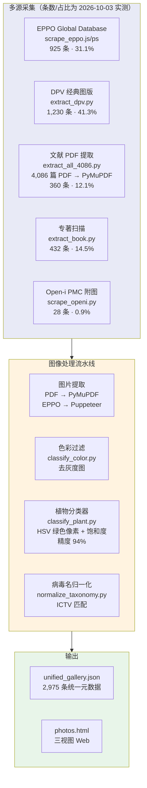

# 10. Virus Photos — 植物病毒症状图库与电镜照片

> 多源采集（5 类来源：EPPO / DPV / 专著 / 文献 PDF / Open-i）、双分类器过滤、**2,975 条**精选病毒病害图库记录（统计日期 2026-10-03，实测自 `docs/data/unified_gallery.json`）。Gallery / Dashboard / Data Table 三视图 Web 界面。

**Live**: http://39.106.101.94/photos/

---

## 架构



---

## 图像处理流水线

### 1. 采集阶段

| 来源 | 工具 | 方法 | 产出 |
|:-----|:-----|:-----|:-----|
| **EPPO** | `scrape_eppo.js` (Puppeteer) + `scrape_eppo_photos.py` | Web 爬虫 + 图片 URL 提取 | `eppo_virus_photos.tsv` + 图片 |
| **DPV** | `extract_dpv.py` + `extract_dpv_tags.py` | 经典图版文字提取 + 标注 | DPV 图版 + 关键词 |
| **PDF 文献** | `extract_all_4086.py` (PyMuPDF) | 4,086 篇论文 PDF ≥ 100×80px 图片提取 | `all_pdf_images/` + JSON 元数据 |
| **专著** | `extract_book.py` + `parse_book.py` | PDF 章节+图版提取 | 专著图片 + 文字关联 |
| **Open-i** | `scrape_openi.py` | NIH Open-i API 检索 PMC 论文附图 | `docs/data/openi_gallery.json` |

### 2. 过滤阶段

```
原始图片 (4,086 篇 PDF)
    │
    ├── classify_color.py ──→ 过滤灰度图
    │   · 饱和度通道分析
    │   · 保留彩色图片 → color/
    │
    ├── classify_plant.py ──→ 植物/非植物分类
    │   · HSV 色彩空间转换
    │   · 绿色像素占比 ≥ 8% (H: 50°–170°)
    │   · 饱和度 ≥ 20, 明度 ≥ 20
    │   · 排除白色/灰色背景 (>85% 亮度)
    │   · 精度: 94% (精确率)
    │   · 输出: plant/ vs non_plant/
    │
    └── 去除非植物图片
        · 显微镜图 (细胞/组织切片)
        · 凝胶电泳图
        · 统计图表
        · 分子结构图
```

### 3. 归一化阶段

```
normalize_taxonomy.py
    │
    ├── 病毒名 → ICTV 规范名 (name_mapping.tsv)
    ├── 宿主名 → 拉丁学名
    └── 统一元数据格式 → unified_gallery.json
```

---

## 元数据结构

```json
{
  "virus": "Tobacco mosaic virus",
  "virus_latin": "Tobamovirus tabaci",
  "hosts": ["tobacco", "tomato"],
  "hosts_latin": ["Nicotiana tabacum", "Solanum lycopersicum"],
  "symptoms": ["mosaic", "chlorosis"],
  "parts": ["leaf"],
  "source": "EPPO",
  "caption": "TMV systemic mosaic symptoms on tobacco leaf",
  "thumb": "data/eppo_images/thumb_001.jpg",
  "full": "data/eppo_images/full_001.jpg"
}
```

---

## Web 界面 (三视图)

### Dashboard 视图

```
┌──────────────────────────────────────────────────────────┐
│  KPI 统计卡片（数值为 2026-10-03 实测）                    │
│  ┌─────────┐ ┌─────────┐ ┌─────────┐ ┌─────────┐       │
│  │ 2,975   │ │ 5 类    │ │ 29.2%   │ │ 33.6%   │       │
│  │ 图库条目 │ │ 来源    │ │ 花叶型  │ │ 叶部    │       │
│  └─────────┘ └─────────┘ └─────────┘ └─────────┘       │
│  ┌──────────────────────┐ ┌──────────────────────────┐  │
│  │ Top Host 柱状图      │ │ Top Symptom 饼图         │  │
│  │ (Chart.js)           │ │ (Chart.js)               │  │
│  └──────────────────────┘ └──────────────────────────┘  │
│  ┌──────────────────────┐ ┌──────────────────────────┐  │
│  │ Tissue 分布           │ │ Virus Family 分布        │  │
│  └──────────────────────┘ └──────────────────────────┘  │
└──────────────────────────────────────────────────────────┘
```

> KPI 口径：花叶型 = 症状含 mosaic 的条目占比（多标签）；叶部 = 部位含"叶/leaf"的条目占比（多标签，故各类型合计 >100%）。

### Gallery 视图

- **卡片式**浏览，每张卡片包含: 缩略图 + 病毒名 + 宿主 + 症状 + 部位
- **多维筛选**: 按来源 (EPPO/DPV/Book/PDF/Open-i) / 宿主 / 症状 / 部位 / 病毒
- 单击放大: 全尺寸图片 + 完整元数据

### Data Table 视图

- 可搜索、排序、分页的完整数据表
- 列: Virus | Host | Symptom | Part | Source | Caption
- **Submit Correction**: GitHub Issue 模板提交元数据修正

---

## 数据量统计

> **实测日期 2026-10-03**，直接统计 `docs/data/unified_gallery.json`（每行一条图库记录）。
> 旧版 README 的 "925 张 / 四来源 / 42%-18%-29%-11%" 与实测不符（925 实际是 EPPO 单源条数），已按实测口径重写。

| 来源（source 标签） | 条数 | 占比 | 特点 |
|:-----|:----:|:----:|:-----|
| DPV 经典图版 | 1,230 | 41.3% | 含电镜照片，历史图版 |
| EPPO Global Database | 925 | 31.1% | 标准病害照片，经济重要病害 |
| 专著扫描 (`Book`) | 432 | 14.5% | 系统教材图片 |
| 文献 PDF 提取 | 360 | 12.1% | 最新发表论文附图；由 `'PDF'` 13 条 + `'pdf'` 347 条合并（历史标签不统一，本次已把 `build_lit_gallery.py` 统一为 `'PDF'`） |
| Open-i (PMC 附图) | 28 | 0.9% | NIH Open-i 检索的论文附图 |
| **合计** | **2,975** | **100%** | 5 类来源（JSON 中因历史遗留存在 6 个 source 标签） |

> ⚠️ **版权/许可提示（2026-10-03 审计）**：`unified_gallery.json` 的全部 2,975 条**均无
> license/rights 字段**，DPV 图版版权属 BSA，EPPO/专著/文献 PDF 各有其条款；对外公开发布或
> 再分发这批图片前须逐源取得许可或改为外链。本 README 只修正计数口径，未改动任何图片与数据文件。

症状分布（多标签占比，同一张图可有多个症状；另有 832 条（28.0%）无症状标注）:
| 类型 | 占比 |
|:-----|:----:|
| Mosaic (花叶) | 29.2% |
| Necrosis (坏死) | 17.3% |
| Yellowing (黄化) | 16.9% |
| Chlorosis (褪绿) | 15.7% |
| Lesion (病斑) | 13.0% |
| Mottle (斑驳) | 11.5% |
| Ringspot (环斑) | 6.3% |

---

## 文件结构

```
10.virus_photos/
├── scrape_eppo.js              # EPPO Puppeteer 爬虫
├── scrape_eppo_photos.py       # EPPO 图片 URL 提取
├── scrape_openi.py             # Open-i (PMC 附图) 搜索+下载
├── extract_dpv.py              # DPV 图版文字提取
├── extract_dpv_tags.py         # DPV 标注/关键词提取
├── extract_book.py             # 专著章节+图版提取 (PyMuPDF)
├── parse_book.py               # 专著文本解析
├── rebuild_book.py             # 专著内容重建 (标签+图片关联)
├── extract_all_4086.py         # 全量 PDF → 图片提取 (4,086 篇)
├── extract_all_flat.py         # PDF 扁平提取变体
├── extract_all_new_virus.py    # 新病毒图片提取
├── find_new_virus.py           # 新病毒检测
├── classify_color.py           # 色彩过滤器 (去灰度)
├── classify_plant.py           # 植物/非植物分类器 (HSV, 94% 精度)
├── delete_grayscale.py         # 灰度图删除
├── filter_structured.py        # 结构化图片过滤
├── scan_all_pdfs.py            # PDF 批量扫描
├── download_ncbi_eve.py        # NCBI EVE 下载
├── build_gallery_json.py       # 生成统一图鉴 JSON
├── normalize_taxonomy.py       # 病毒名归一化 (ICTV 匹配)
├── aps_extract.js              # APS 提取
├── 15587070.pdf                # 参考专著 PDF
├── 15587070.docx               # 专著提取文本
├── eppo_virus_photos.tsv       # EPPO 图片元数据
├── extracted/                  # 提取产物
│   ├── images/                 # Web 用处理后的图片
│   ├── all_pdf_images/         # PDF 提取的全部图片
│   │   └── color/              # 彩色子集
│   │       ├── plant/          # 植物分类 (最终使用)
│   │       └── non_plant/      # 非植物 (显微镜/凝胶/图表)
│   └── new_virus_all/          # 新病毒图片
└── archive/                    # 归档原始脚本
    └── debug/                  # 调试记录
```

---

## 快速开始

```bash
# EPPO 爬取 (需要 Node.js + Puppeteer)
node scrape_eppo.js
python scrape_eppo_photos.py

# DPV 提取
python extract_dpv.py
python extract_dpv_tags.py

# PDF 全量提取 (需要 PyMuPDF)
python extract_all_4086.py

# 专著提取
python extract_book.py
python parse_book.py

# 图像分类过滤
python classify_color.py       # 去灰度
python classify_plant.py       # 植物/非植物 (94% 精度)

# 归一化 + 生成 Web 数据
python normalize_taxonomy.py
python build_gallery_json.py   # → unified_gallery.json

# 部署到 docs/photos.html
```

---

## 部署

| 项目 | 配置 |
|:-----|:-----|
| **类型** | 纯静态 (Nginx 直接服务) |
| **路径** | `/opt/plant_virus_db/plant_virus_db_pipeline/docs/photos.html` |
| **Nginx** | `/photos/` → alias `docs/photos.html` |
| **图片** | `docs/data/{source}_images/` (book/dpv/eppo/pdf) |
| **元数据** | `docs/data/unified_gallery.json` |
