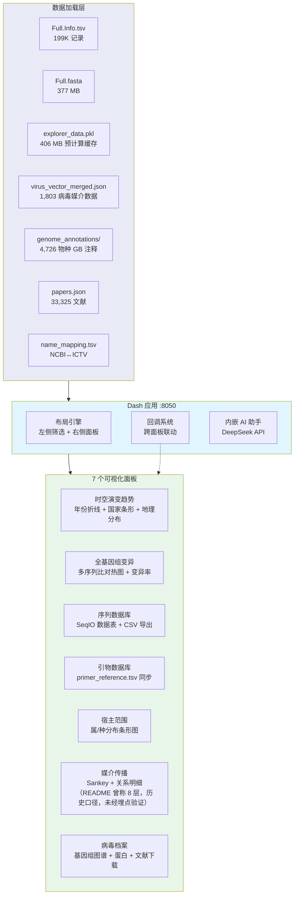
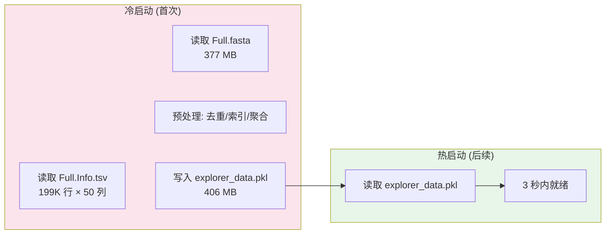

# 3. Virus Explorer — 植物病毒数据交互式浏览器

> Dash + Plotly 交互式数据浏览器。时空演变、全基因组变异、媒介传播网络、病毒档案，七个可视化面板 + 内嵌 AI 助手。

**Live**: http://39.106.101.94/explorer/

---

## 架构



---

## 左侧筛选面板

7 个联动筛选器，全部带实时计数：

| 筛选器 | 类型 | 联动范围 |
|:-------|:-----|:---------|
| 宿主种类 | MultiSelect + 计数 | 全部面板 |
| 目标国家/地区 | Dynamic MultiSelect | 地理分布 + 序列表 |
| 基因组结构 | 分段/非分段 + 计数 | 全部面板 |
| 病毒科 (Family) | MultiSelect + 计数 | 全部面板 |
| 序列完整性 | Complete/Partial + 计数 | 全部面板 |
| 目标病毒物种 | MultiSelect (跟随 Family 联动) | 全部面板 |
| 年份范围 | RangeSlider + 数据源选择 (采集/提交) | 时间趋势 + 序列表 |

---

## 七个面板详解

### 1. 时空演变趋势图

```
┌─────────────────────────────────────────────────┐
│  [年份折线图] 每年新序列提交/采集数量趋势       │
│  ┌─────────────────────────────────────────┐    │
│  │  /\    /\                                │    │
│  │ /  \  /  \    /\                         │    │
│  │/    \/    \__/  \________________________│    │
│  └─────────────────────────────────────────┘    │
│  [国家条形图] Top 20 国家序列分布               │
│  [地理分布] Choropleth 世界地图                 │
└─────────────────────────────────────────────────┘
```

- 双模式: 按提交年份 / 按采集年份
- 范围滑块联动: 拖动年份区间时实时更新所有面板

### 2. 全基因组变异分析

- **多序列比对热图**: Plotly 交互式热图，支持缩放/平移
- **变异率曲线**: 滑动窗口变异率，识别高变区
- **Top 10 变异热点**: 基因组位置 + 变异频率表
- 比对引擎: `Bio.Align.PairwiseAligner` 全局双序列比对

### 3. 高稳健序列数据库

- 类 DataTable 视图，支持排序/筛选/CSV 导出
- 列: Accession, Species, Length, Genome_Type, Host, Country, Year
- 跟随左侧所有筛选器实时过滤

### 4. 引物数据库

- 同步 `primer_reference.tsv`，显示当前筛选物种的可用引物
- 列: Primer_ID, Species, Type, Score, Recommendation
- 点击跳转 `/primers/` 详情页

### 5. 宿主范围

- **属级条形图**: 当前筛选条件下病毒宿主属分布
- **种级分布表**: Top 宿主物种列表
- 点击条形可下钻到宿主物种层级

### 6. 媒介传播网络

> 注：下图为**历史口径示意（8 层）**，未经埋点验证；当前实现为 3 层 Virus → Vector Species → Host。

```mermaid
sankey
    Virus_Family,Viruses,Virus_Species,Vector_Family,Vector_Genus,Vector_Species,Mechanism,Host
```

- **Sankey 图（历史口径"8 层"，未经埋点验证；当前实现为 3 层 Virus → Vector Species → Host，见 `app.py:_build_vector_sankey`）**: 原描述为 Virus Family → Genus → Species → Vector Family → Genus → Species → Mechanism → Host
- **焦点高亮**: 点击节点高亮相关路径
- **关系明细表**: 列出所有病毒-媒介-宿主三元组
- 数据源: `../8.plant-insect/virus_vector_merged.json`

### 7. 病毒档案 (集成 Virus Profile)

- **基因组图谱**: CDS 箭头图 (线性) 或环状基因组图
- **蛋白列表**: 从 `.gb` 文件解析的 CDS 位置 + Product + Protein ID
- **下载**: 5 格式下载 (genome/cds/protein FASTA + GFF3 + GenBank)
- **文献**: 从 papers.json 匹配的相关论文
- **实时联动**: 跟随左侧物种/科/年份筛选

---

## 数据加载策略



- 首次加载: ~22 秒 (全量解析 + 预计算)
- 缓存命中: < 3 秒 (pickle 反序列化)
- 缓存文件: `explorer_data.pkl` (406 MB, gitignore)

---

## 内嵌 AI 助手

- **入口**: 右下角浮动按钮
- **模型**: DeepSeek API (服务端代理)
- **功能**: 自然语言查询数据 (如 "显示 Potyviridae 科 2020 年后的序列")
- **使用量**: 平均 150 次/周（历史口径，未经埋点验证）
- **查询类型分布**: 物种级检索 41% | 科级统计 28% | 比较分析 19% | 其他 12%（历史口径，未经埋点验证）

---

## 文件结构

```
3.virus_explorer/
├── app.py                    # 主应用 (110,106 行)
│                             #   Dash 布局 + 全部回调函数
├── app_server.py             # 生产服务器版本 (114,889 行)
│                             #   Gunicorn 入口
├── README.md                 # 本文档
├── deploy.sh                 # 部署脚本 (4,560 行)
├── requirements.txt          # Python 依赖
└── archive/patches/          # 20 个历史补丁
    ├── add_circular_genome.py    # 环状基因组支持
    ├── add_ncbi_link.py          # NCBI 直链
    ├── add_profile_sync.py       # Profile 同步
    ├── fix_alignment*.py         # 比对功能修复 (3次迭代)
    ├── fix_gbdraw_*.py           # 基因组绘图修复 (3次)
    ├── fix_explorer_callback.py  # 回调修复
    ├── fix_sync.py               # 同步修复
    ├── fix_zoom.py               # 缩放修复
    ├── fix_titles.py             # 标题修复
    ├── gbdraw_svg_embed.py       # SVG 嵌入
    ├── gbdraw_png_switch.py      # PNG 切换
    ├── integrate_gbdraw.py       # GBDraw 集成
    └── apply_all_fixes.py        # 批量修复
```

---

## 技术栈

| 层级 | 技术 |
|:-----|:-----|
| 框架 | Dash (Plotly) |
| 可视化 | Plotly (折线/条形/热图/Sankey/Choropleth) |
| 前端组件 | Mantine Components |
| 比对 | Bio.Align.PairwiseAligner |
| 缓存 | pickle 预计算 + 内存 |
| 生产 | Gunicorn --preload, 1 worker + 2 threads |
| Python | 3.6 兼容 |

---

## 部署

| 项目 | 配置 |
|:-----|:-----|
| **systemd** | `virus-explorer.service` → :8050 |
| **Gunicorn** | `gunicorn -w 1 --threads 2 -b 127.0.0.1:8050 app:server --preload` |
| **Nginx** | `/explorer/` → :8050 + `/_dash-*/` WebSocket |
| **proxy_buffering** | `off` (Dash WebSocket 长连接必须) |
| **内存** | ~2 GB (全量 DataFrame + 缓存) |
