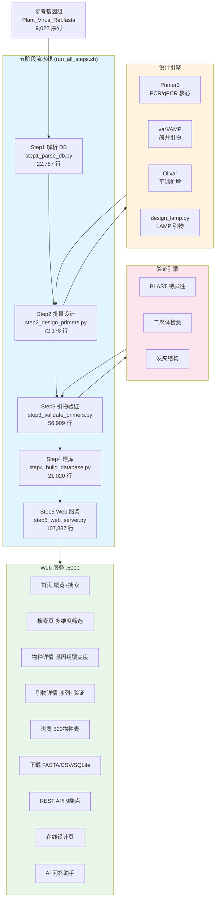
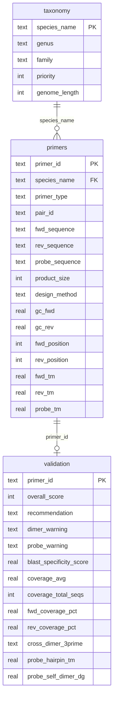
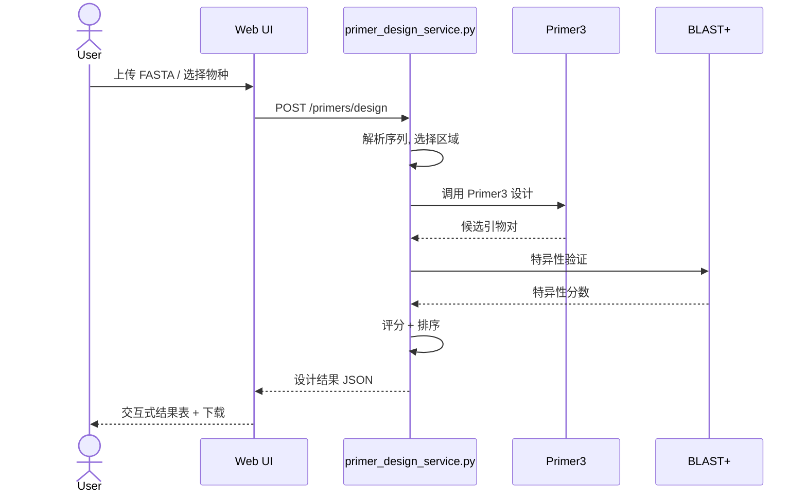

# 4. Virus Primer — 植物病毒诊断引物数据库与设计平台

> 全自动五阶段引物设计流水线 + Flask Web 服务 + 在线引物设计。当前发布批次 **103,642 对设计引物，覆盖 4,789 个植物病毒物种**（2026-06-30 设计快照含 103,642 对；**2026-10-16 已在本地以修复版 step3 完成全量验证并经 step4 合库上线**：按 (物种, Fwd, Rev) 去重后 **83,830 对 / 4,789 物种 / 50 科**，RECOMMENDED 66,891 / USABLE 15,345 / NOT_RECOMMENDED 1,594，旧线上库已备份为 primer_database.db.bak_premerge_20261016）。

**Live**: http://39.106.101.94/primers/

---

## 架构总览



---

## 数据量（2026-06-30 发布快照，实测值）

| 指标 | 数值 |
|:-----|:----:|
| 引物对总数 | **103,642** |
| 覆盖病毒物种 | **4,789** |
| PCR 引物 | 18,101 |
| qPCR 引物 (含探针) | 14,006（其中 9,679 对带探针序列与探针 Tm） |
| Tiled 平铺扩增 | 68,920 |
| Degenerate 简并引物 | 2,615 |
| 设计引擎分布 | Olivar 37,696 / Tiled_Primer3 27,661 / Primer3 18,101 / Primer3_qPCR 14,006 / varVAMP_tiled 3,563 / varVAMP 2,615 |

> **当前线上库（2026-10-16 合库验证后）**：83,830 对去重引物 — TILED 49,165 / PCR 18,089 / qPCR 13,961 / DEGENERATE 2,615；
> 验证 RECOMMENDED 66,891 / USABLE 15,345 / NOT_RECOMMENDED 1,594。上表为 2026-06-30 设计快照（去重前）。

### 当前发布数据说明（重要）

本批次为**设计产物快照**，各字段的实际覆盖情况：

| 字段 | 覆盖率 | 说明 |
|:-----|:------:|:-----|
| 引物/探针序列、产物长度、位置 | 100% | 所有引擎产出 |
| Fwd/Rev Tm | 63.6% | Olivar 路径（37,696 对）未输出 Tm |
| GC% | 列齐全 | 但 Olivar/varVAMP 路径的 43,874 行为占位 0，非实测值 |
| Segment（节段归属） | 21.7% | 仅多节段病毒 |
| 简并度（Fwd/Rev/Total_Degeneracy） | 0% | 简并引物的简并度未导出 |
| **验证字段（评分/推荐级别/二聚体/BLAST 特异性/覆盖度）** | **无** | **本批次未运行 step3，`validation` 表无有效数据，推荐级别不可用** |

> ⚠️ **使用提示**：当前批次请将本库作为**设计引物目录**使用（按物种/类型/方法筛选序列与参数），不要按"推荐级别"选择引物。运行 `step3_validate_primers.py`（需本地 NCBI nt ≥200 GB）并重建数据库后，验证字段与推荐级别才会生效。

---

## 五阶段流水线详解

### Step 1: 解析参考数据库 (`step1_parse_db.py`)

从 `Plant_Virus_Ref.fasta`（当前 9,022 条非冗余基因组，以 `docs/data/DATA_VERSION` 为准）中提取物种信息、构建基因组索引，为后续引物设计准备模板序列。

- 输入: `Plant_Virus_Ref.fasta` + `Plant_Virus_Ref.Info.tsv`
- 输出: 按物种组织的基因组模板目录
- 去冗余: 同一物种选择代表性基因组作为设计模板

### Step 2: 批量引物设计 (`step2_design_primers.py`)

四引擎并行设计，针对不同应用场景选择合适的工具：

| 引擎 | 适用场景 | 输出类型 |
|:-----|:---------|:---------|
| **Primer3** | 标准 PCR / qPCR | 引物对 + 探针 |
| **varVAMP** | 高变异区简并引物 | 简并引物对 |
| **Olivar** | 全基因组平铺扩增 | Tiled amplicon |
| **design_lamp.py** | 环介导等温扩增 | LAMP 6 引物组 |

- 并行度: 按物种并发（run_all_steps.sh 默认 60 线程，可配）
- 内存需求: ≥ 16 GB
- qPCR 探针: 自动设计 TaqMan 探针（Tm 目标比引物高 5-10°C）

### Step 3: 引物验证 (`step3_validate_primers.py`)

> **注意：当前发布批次未运行本步骤**——下述验证能力已在管线中实现（2026-10-03 修复后经验证），但其结果（评分/推荐级别/二聚体/BLAST 特异性/覆盖度）**不包含在现有发布数据中**。

三道验证（运行 step3 后对每条引物执行）：

```
引物对
  │
  ├── 1. BLAST 特异性验证
  │     ├── 对 NCBI nt 库进行 BLASTN
  │     ├── 计算特异性分数 (期望只有目标物种命中)
  │     └── 标记交叉反应风险
  │
  ├── 2. 二聚体分析
  │     ├── 自身二聚体 (Self-dimer)
  │     ├── 交叉二聚体 (Cross-dimer)
  │     └── 3' 端互补警告
  │
  └── 3. 发夹结构检测
        ├── 引物内部发夹
        └── 探针发夹 (qPCR 专用)
```

- BLAST 依赖: 需要本地 NCBI nt 数据库 (≥ 200 GB)
- 综合评分: 0-100 分，加权特异性 + 二聚体 + 发夹 + 覆盖度

### Step 4: 构建 SQLite 数据库 (`step4_build_database.py`)

将引物数据写入 SQLite 三表结构（`validation` 表结构如下，当前批次该表无有效数据行）：



**推荐级别（管线内置分级规则）**：

> ⚠️ 当前发布批次未生成推荐级别，本表仅为 step3 运行后的分级定义，请勿用于当前数据的选择依据。

| 级别 | 分数 | 含义 |
|:-----|:----:|:-----|
| RECOMMENDED | ≥ 80 | 高特异性，无二聚体警告 |
| USABLE | 60–79 | 可用，可能有轻微二聚体风险 |
| CAUTION | < 60 | 有可用性但需谨慎 |
| NOT_RECOMMENDED | < 60 | 严重二聚体或交叉反应 |

### Step 5: Web 服务 (`step5_web_server.py`)

Flask 全功能 Web 应用，Bootstrap 5 前端。

---

## Web 路由表

| 路由 | 方法 | 功能 | 说明 |
|:-----|:----:|:-----|:-----|
| `/` | GET | 首页 | 数据库概览 KPI + 快速搜索框 |
| `/search` | GET/POST | 引物搜索 | 按物种/属/科/类型/评分/方法多维筛选 |
| `/species/<name>` | GET | 物种详情 | 所有引物列表 + 基因组覆盖度可视化 (Chart.js) |
| `/primer/<id>` | GET | 引物详情 | 序列/Tm/GC%（二聚体/BLAST 字段当前批次为空） |
| `/browse` | GET | 物种浏览 | 500 物种分页表格 |
| `/download` | GET | 数据下载 | FASTA / CSV / SQLite 三种格式 |
| `/api/species` | GET | API | 物种列表 JSON |
| `/api/species/<name>` | GET | API | 物种引物 JSON |
| `/api/primer/<id>` | GET | API | 单引物详情 JSON |
| `/api/search?q=&type=&score=` | GET | API | 参数化搜索 |
| `/api/stats` | GET | API | 数据库统计 |
| `/api/taxonomy` | GET | API | 分类学树 |
| `/api/download/<format>` | GET | API | 程序化下载 |
| `/primers/design` | GET/POST | 在线设计 | 上传 FASTA 或选择物种，实时设计 |
| `/primers/design/status/<job_id>` | GET | API | 设计任务状态查询 |

---

## 在线引物设计工作流



**支持四种模式**:
| 模式 | 说明 | 产物 |
|:-----|:-----|:-----|
| PCR | 标准 PCR 引物对 | 1 对引物，250-1000bp |
| qPCR | TaqMan 探针法 | 引物对 + 探针，80-200bp |
| Degenerate | 简并引物 (varVAMP) | 多序列比对保守区简并 |
| Tiled | 全基因组平铺 (Olivar) | 多对重叠扩增子 |

---

## LAMP 工具集 (lamp_tools/)

集成了 15 个环介导等温扩增 (LAMP) 相关工具的代码：

| 工具 | 语言 | 说明 |
|:-----|:-----|:-----|
| **LAMP-Forge** | Python (Flask + RQ) | 完整 LAMP 面板设计平台，含 Web UI |
| **LAMPrimers-iQ** | Python (Tkinter) | GUI 桌面 LAMP 引物设计 |
| **LAMP-Primers** | Python | LAMP 引物设计核心算法 |
| **LAMP-Primer-Hairpin** | Python | 发夹结构检测与可视化 |
| **primd** | TypeScript (biome) | 现代 LAMP 引物设计 |
| **SimCycle** | Python | LAMP 扩增动力学蒙特卡洛模拟 |
| **lampshade** | R | 引物可视化 R 包 |
| **lamp-virus** | R | 病毒 LAMP 检测 R 包 |
| **lava-dna** | Conda | LAMP 分析 conda 环境包 |
| **GLAPD** | Python + CUDA | GPU 加速 LAMP 引物设计 |
| **AnalysePrimer** | Python | LAMP/PCR 引物分析 |
| **Multiplexed_Coverage_Analysis_v3** | Python | 多重覆盖度分析 |
| **LAMProject** | JavaScript (Electron) | 跨平台桌面应用 |
| **LAMP_primer_hairpin_detector_and_debugger** | JavaScript | Web 版发夹检测 |
| **R-LampPrimerAnalyzer** | R | R 语言全套 LAMP 分析脚本 |

---

## 工具脚本 (tools/)

| 脚本 | 行数 | 功能 |
|:-----|:----:|:-----|
| `export_primers_static.py` | 8,925 | 导出引物数据为静态 JSON (供 docs/primers/) |
| `patch_olivar_positions.py` | 3,025 | 修复 Olivar 平铺引物位置标注 |
| `test_blast_batch.py` | 12,074 | BLAST 批量验证测试 |
| `varvamp_workflow.py` | 16,109 | varVAMP 简并引物设计工作流 |

---

## 快速开始

```bash
# 一键运行全流程 (需先有 Plant_Virus_Ref.fasta)
bash run_all_steps.sh

# 或分步运行:
python step1_parse_db.py          # 解析参考数据库
python step2_design_primers.py    # 批量引物设计 (需 Primer3 + BLAST)
python step3_validate_primers.py  # 引物验证 (需 NCBI nt ≥200GB)
python step4_build_database.py    # 构建 SQLite 数据库
python step5_web_server.py        # 启动 Web 服务 → :5000
```

## 生产部署

```bash
# Gunicorn 生产模式 (Linux)
gunicorn -w 4 -b 127.0.0.1:5000 step5_web_server:app

# Windows 开发模式
waitress-serve --port=5000 step5_web_server:app

# 在线设计服务 (独立进程)
python primer_design_service.py --port 5001
```

---

## 部署注意

| 项目 | 说明 |
|:-----|:-----|
| **服务器路径** | `/opt/plant_virus_db/primer_design_server/` (非本地 `4.virus_primer/`) |
| **systemd** | `primer-web.service` → :5000 |
| **Nginx** | `/primers/` → proxy_pass :5000 |
| **数据库** | `primer_database.db` (SQLite, 约 80 MB) |
| **BLAST 依赖** | step3 需要本地 NCBI nt ≥ 200 GB |
| **Python** | 3.10–3.12, 优先 `pixi run` |
| **Primer3** | Linux: 系统 `primer3` 二进制; Windows: `primer3-py` |
