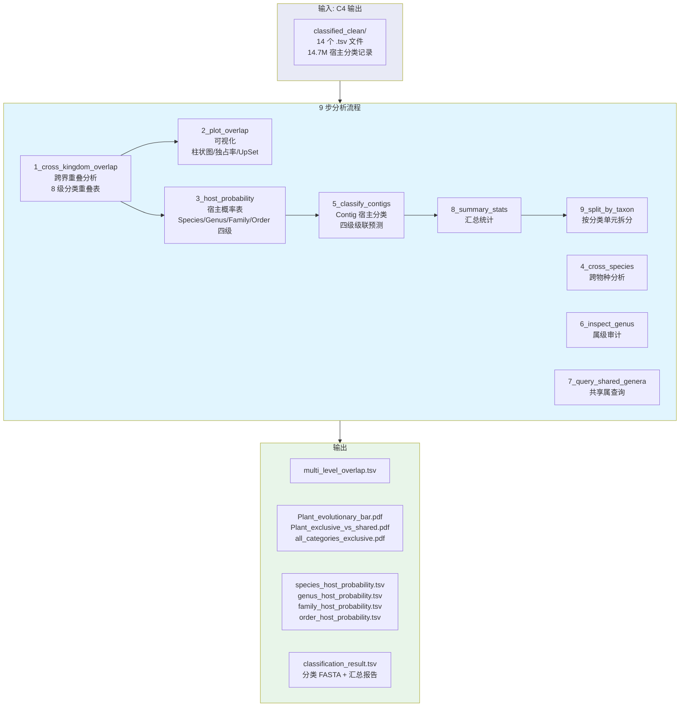
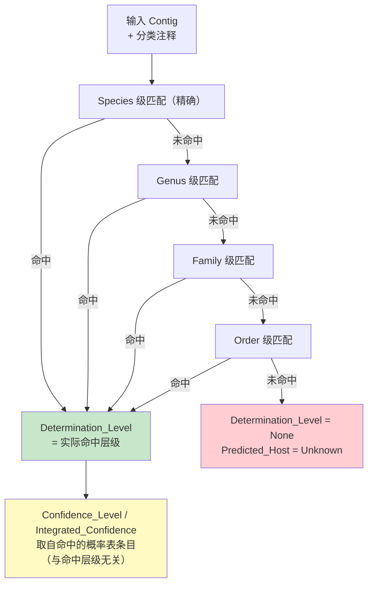

# 5. Host Classify — 病毒宿主分类与跨界分析

> 对 Module 1 (C4) 清洗后的植物病毒数据进行宿主分类、跨界污染量化、概率查找表构建、Contig 级级联宿主预测。9 个分析步骤，双因子置信度模型。

---

## 目的

1. **量化跨界污染程度** — 植物病毒在真菌/昆虫/动物等非植物宿主中的分布
2. **构建宿主概率查找表** — 属/科/种/目四级 `P(host | taxon)`，含双因子置信度
3. **Contig 级宿主分类** — 基于病毒注释结果的四级级联宿主预测

---

## 架构



---

## 置信度模型

双因子模型评估 `P(host | taxon)`：

```
P(host | taxon) = C_ent × C_sup

其中:
  C_ent (专一性) = 1 − H / log(N)
    H = 香农熵 (该分类单元内宿主分布均匀度)
    N = 宿主类别数
    独占属 → C_ent = 1.0
    均匀分布 → C_ent → 0.0

  C_sup (支持度) = 1 − e^(−n/5)
    n = 该分类单元的记录数
    n ≥ 15 → C_sup ≥ 0.95
    n = 1  → C_sup ≈ 0.18 (singleton 惩罚)
```

| 置信度 | 阈值 | 含义 |
|:-------|:----:|:-----|
| **High** | ≥ 0.8 | 宿主关联可信度高，可用于下游决策 |
| **Medium** | 0.4–0.8 | 有一定证据，需谨慎使用 |
| **Low** | < 0.4 | 证据不足，仅作参考 |

---

## Contig 分类：两个独立维度

⚠️ 实现说明（2026-10-03 审计修正）：**命中层级 ≠ 置信度**。`5_classify_contigs.py` 输出的两个字段来自不同来源：

| 维度 | 字段 | 来源 | 取值 |
|:-----|:-----|:-----|:-----|
| 命中层级 | `Determination_Level` | 级联匹配在哪一级命中（含列偏移容错标注） | `Species/Genus/Family/Order(via <列名>)`；全不命中为 `None` |
| 置信度 | `Confidence_Level` / `Integrated_Confidence` | **命中条目的概率表记录本身** —— 由 `3_host_probability.py` 的双因子模型计算（见上节），与命中层级无关 | `High / Medium / Low (Singleton/Rare) / Low (Shared Genus) / Unknown` |

- 级联顺序 Species → Genus → Family → Order（最具体优先）；候选按 `(命中层级, 概率表置信度)` 降序排序 —— **层级优先，置信度仅作同层级内的平局裁决**，故 Species 命中即便置信度 Low 也压过 Genus 命中。
- 含列偏移容错：上游合并引入的 Subphylum/Suborder 等额外列会造成"列名 ≠ 实际层级"，此时记为 `Genus(via Species)` 一类标注。
- 全层级未命中 → `Predicted_Host=Unknown, Determination_Level=None`。



---

## 流程

```bash
# === 1. 跨界重叠分析 ===
python 1_cross_kingdom_overlap.py \
    -i classified_clean/ -o cross_analysis/ -s Plant

# 输出:
#   cross_analysis/multi_level_overlap.tsv      # 8 级分类重叠表
#   cross_analysis/cross_kingdom_all_details.tsv # 种级详细分类
#   cross_analysis/cross_details/*.tsv           # 每类详情

# === 2. 可视化 ===
python 2_plot_overlap.py -i classified_clean/ -o cross_analysis/
# 可选: 真正排除 HVT 家族后再统计绘图 (默认关闭; 开启后图题注明 HVT families excluded)
python 2_plot_overlap.py -i classified_clean/ -o cross_analysis/ --exclude-hvt

# 输出:
#   cross_analysis/Plant_evolutionary_bar.pdf    # 分组柱状图
#   cross_analysis/Plant_exclusive_vs_shared.pdf # 独占/共享比
#   cross_analysis/all_categories_exclusive.pdf  # 各类别独占率
#   cross_analysis/Plant_upset_matrix_*.csv      # UpSet 矩阵

# === 3. 宿主概率表 (含置信度) ===
python 3_host_probability.py -i classified_clean/ -o cross_analysis/

# 输出:
#   cross_analysis/species_host_probability.tsv  # 种级 P(host|species)
#   cross_analysis/genus_host_probability.tsv    # 属级 P(host|genus)
#   cross_analysis/family_host_probability.tsv   # 科级 P(host|family)
#   cross_analysis/order_host_probability.tsv    # 目级 P(host|order)

# === 4. 跨物种分析 ===
python 4_cross_species.py -i classified_clean/cross_species/ -o cross_analysis/

# === 5. Contig 宿主分类 ===
python 5_classify_contigs.py \
    -i final_integrated_classification.tsv \
    -f contigs.fasta \
    --prob_dir cross_analysis/ \
    -o classified/ \
    --mode medium

# 输出:
#   classified/{Category}.classified.tsv         # 每类完整表格
#   classified/{Category}.classified.fasta       # High+Medium 序列
#   classified/classification_result.tsv         # 全量分类结果
#   classified/classification_summary.tsv        # 统计汇总
#   classified/confidence_report.tsv             # 置信度分布

# === 6-7. 审计 (按需) ===
python 6_inspect_genus.py Plant Fungi Alphapartitivirus
python 7_query_shared_genera.py Plant Fungi

# === 8. 汇总统计 ===
python 8_summary_stats.py

# === 9. 按分类单元拆分 ===
python 9_split_by_taxon.py -i classified/ -o split_output/
```

---

## 9 个步骤详解

| 步骤 | 脚本 | 行数 | 功能 |
|:----:|:-----|:----:|:-----|
| 1 | `1_cross_kingdom_overlap.py` | 224 | 跨界重叠: 8 级 (Realm→Species) 分类重叠统计; 定义跨脚本共用口径常量 `CATEGORIES_SKIP`/`HVT_FAMS`/`COLLISION_GENERA` |
| 2 | `2_plot_overlap.py` | 375 | 可视化: 柱状图/独占率/UpSet 矩阵; `--exclude-hvt` 开关 (默认关, 图题如实) |
| 3 | `3_host_probability.py` | 165 | 概率表: 双因子置信度模型 P(host\|taxon), 复用 1 号脚本的 `CATEGORIES_SKIP` |
| 4 | `4_cross_species.py` | 145 | 跨物种: 相同病毒在不同宿主中的分布 |
| 5 | `5_classify_contigs.py` | 299 | 分类: Species→Genus→Family→Order 四级级联; 概率表数值列空值容错 |
| 6 | `6_inspect_genus.py` | 88 | 审计: 指定属的宿主分布检查 |
| 7 | `7_query_shared_genera.py` | 75 | 查询: 两个宿主界共享的病毒属 |
| 8 | `8_summary_stats.py` | 169 | 汇总: 全量宿主分类统计 |
| 9 | `9_split_by_taxon.py` | 184 | 拆分: 按分类单元拆分序列文件 (覆盖写, 可重复执行) |

> 行数为 2026-10-03 `wc -l` 实测值（旧版表格误把字节数当行数，虚报约 20–40 倍）。

### 补充绘图脚本（本地复现）

| 脚本 | 行数 | 功能 | 数据来源 |
|:-----|:----:|:-----|:---------|
| `10_plot_genus_host_VMR.py` | 259 | 属级宿主独占/共享 4 面板图 (donut / 共享界条形 / 各阶元独占率 / 物种界分布) | **本地可复现**：`docs/data/VMR_MSL41.txt` (ICTV MSL41, 2024, 19,271 条记录)。实测植物相关属 n=263，严格独占 190 (72.2%)；剔除环境来源 (S) 样本后 206 (78.3%) |
| `11_plot_exclusive_vs_shared.py` | 120 | 复现服务器版 "Virus Genus Exclusive vs Shared per Host Category" 堆叠柱状图 | ⚠️ **硬编码"原图标注"数据**（Bacteria 1657+1、Plant 183+10=95% 等 7 类），无本地原始数据；仅用于样式复现，**不参与任何统计结论** |

---

## 属级独占率口径说明（2026-10-03）

历史文档出现过 4 个互斥数字，出处与定义域如下（引用请用第 3 行）：

| 数值 | 出处 | 定义域 | 可复现性 |
|:-----|:-----|:-------|:---------|
| ~90% | 本 README 旧版"预期值" | 未定义 | ❌ 无口径、无产物 |
| 95% | `11_plot_exclusive_vs_shared.py` 硬编码"原图标注" (Plant 183/193) | 服务器版 C4 `classified_clean/` 一次性统计 | ❌ 原图数据未入库 |
| 72.2% | `10_plot_genus_host_VMR.py` 实测 | ICTV MSL41 VMR，植物相关属 n=263，严格"仅植物" | ✅ 本地可复跑 |
| 78.3% | 同上（剔除环境来源口径） | n=263，宿主集合去除 Environmental (S) 后仅植物 | ✅ 本地可复跑 |

差值 16 个属为"植物宿主 + 环境来源 (S)"共现的属（如土壤/水体宏基因组样本）；两者均不把 Unknown/Environmental_NCBI/Algae 计入"其他宿主界"（`CATEGORIES_SKIP` 统一口径）。

---

## 预期结果

| 指标 | 期望值 | 说明 |
|:-----|:------:|:-----|
| 种级跨界 | > 0 (≤ 100) | ICTV 确认的增殖型双宿主 (如 TSWV) |
| 属级独占率 | 72.2% / 78.3% | ICTV MSL41 VMR 实测（见上节口径说明；旧 "~90%" 无出处已废弃） |
| 分类成功率 | > 98% | Contig 宿主分类成功率 |
| Unknown | < 2% | 无可匹配分类单元的 contig |

---

## 前置依赖

```
classified_clean/          # C4 输出 (14 个 .tsv 文件)
cross_analysis/            # C7 概率表输出目录
```
