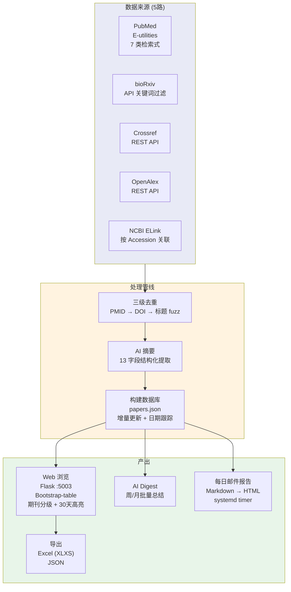

# 7. Literature Tracker — 植物病毒文献自动追踪系统

> 多源文献抓取 → AI 结构化摘要 → 每日邮件报告 → Flask Web 浏览。9 类 PubMed 检索策略 + 4 源补充 (bioRxiv/arXiv/Crossref/OpenAlex)。

**Live**: http://39.106.101.94/literature/

---

## 架构



---

## CLI 自动化

`pipeline.py` 提供六种命令的 CLI 工具:

```
pipeline.py fetch       # 从指定 source 抓取论文 (keyword/elink/species/preprint)
pipeline.py summarize   # AI 摘要待处理论文
pipeline.py build       # 构建 Web 数据文件 (合并 + 去重 + 期刊质量 + 年度拆分)
pipeline.py auto        # fetch → build → summarize → build
pipeline.py stats       # 年份/类别统计
pipeline.py historical  # 批量回溯 2020-2026
```

各 fetch 子脚本通过 `subprocess.run()` 依次调用 (非并行), 输出临时 JSON 后通过 `dedup_key` + `merge_paper` 跨源合并去重。

---

## 数据量

| 指标 | 数值 |
|:-----|:----:|
| 精选文献总计 | 6,525（master 全库 33,325） |
| AI 摘要 (13 字段) | `summarize_papers.py` 按需生成 |
| PubMed PDF 全文 | 8.25 GB (gitignore) |
| 日/周/月报告 | cron 自动生成 |

---

## 检索源

| 源 | 方法 | API |
|:---|:-----|:-----|
| **PubMed** | NCBI E-utilities (esearch + efetch) | eutils.ncbi.nlm.nih.gov |
| **bioRxiv** | API 关键词过滤 | api.biorxiv.org |
| **Crossref** | REST API | api.crossref.org |
| **OpenAlex** | REST API (含摘要倒排索引重建) | api.openalex.org |

---

### 检索策略

PubMed 检索式由 `config.py` 的 `QUERY_CATEGORIES` 定义, **9 个主题类别**:

| 类别 | 聚焦方向 |
|:-----|:-----|
| **New_Virus** | 新病毒发现 (novel virus, first report, complete genome + novel, viroid discovery) |
| **Molecular_Characterization** | 基因组/分子特征 (complete genome, phylogenetic, recombination, RdRp/CP/MP 蛋白) |
| **Detection_Methods** | 检测与诊断 (RT-PCR/qPCR/LAMP/RPA/ELISA/CRISPR, field-deployable) |
| **Host_Virus_Interactions** | 宿主-病毒互作 (抗性/RNAi/HR/PCD/症状/易感基因) |
| **Antiviral_Resistance_Genes** | 抗病毒基因与机制 (NLR/NBS-LRR/eIF4E/自噬/泛素/SA/JA/ET 信号) |
| **Transmission_Epidemiology** | 传播与流行病学 (媒介/蚜虫/烟粉虱/蓟马/种传/流行病/暴发) |
| **Control_Management** | 防控与管理 (交叉保护/弱毒株/生防/抗性品种育种) |
| **Viral_Diversity_Ecology** | 病毒多样性与生态 (宏病毒组/HTS/NGS/sRNA-seq/进化/生态) |
| **Biotechnology_Applications** | 生物技术应用 (VIGS/病毒载体/VLP/纳米/重组蛋白/瞬时表达) |

---

## AI 功能

### 论文 AI 摘要

`summarize_papers.py` 通过 `_llm_call()` (urllib POST 到 OpenAI 兼容 API) 调用 LLM。系统提示词定义 **13 字段** 中文结构化提取:

| 字段 | 内容 |
|:-----|:-----|
| virus_name | 病毒名称 (含缩写) |
| taxonomy | 分类地位 (目/科/属/种) |
| symptoms | 植物症状 |
| host_plant | 宿主植物 |
| location | 采样地理位置 |
| sample_date | 采样时间 |
| vector | 传播媒介生物 |
| transmission | 传播方式 |
| overview | 研究概况 (≤80字) |
| methods | 主要方法 (≤60字) |
| results | 主要结果 (≤100字) |
| discussion | 讨论要点 (≤80字) |
| is_review | 综述/研究论文判定 |

严格要求仅根据标题摘要提取, 不推测, 信息缺失填 "未提及"。返回严格 JSON。

### AI Digest

- 批量论文的周/月总结
- 趋势关键词提取
- 研究热点变迁追踪

### RAG 问答

- 知识库驱动的植物病毒学 Q&A
- 与 `6.knowledge_rag` 模块联动

---

## 文件结构

```
7.literature_tracker/
├── api_server.py              # Flask Web 服务 (:5003, /literature/)
├── config.py                  # 文献模块配置
├── build_data.py              # 构建 papers.json (合并 + 日期跟踪)
├── fetch_pubmed.py            # PubMed E-utilities 多策略检索
├── fetch_preprints.py         # arXiv/bioRxiv 预印本抓取
├── fetch_linked_papers.py     # NCBI ELink 按 accession 关联文献
├── fetch_species_papers.py    # 按物种名检索
├── digest.py                  # DeepSeek AI 摘要生成
├── dedup.py                   # 三级去重 (PMID/DOI/标题相似度)
├── download_pubmed.py         # PubMed PDF 批量下载
├── download_genbank.py        # GenBank 记录下载 (供注释构建)
├── build_annotation.py        # 本地 genome_annotations 注释
├── download_pmc_pdf.py        # PMC 全文 PDF 下载
├── pmc_fulltext.py            # PMC 全文文本提取
├── europepmc_v2.py            # Europe PMC API 检索
├── pipeline.py                # 全流程编排
├── build_rag.py               # RAG 知识库构建
├── summarize_papers.py        # 论文批量 AI 摘要
├── summarize_batch.py         # 分批摘要生成
├── summarize_by_category.py   # 按分类摘要
├── run_summarize_batches.py   # 批量摘要调度
├── update_cron.sh             # cron 更新脚本
├── literature-tracker.service # systemd 服务配置
├── web/                       # 文献 Web 前端 (Flask templates)
├── data/                      # 数据库 (Journals/MeSH/Categories)
├── scripts/                   # 辅助脚本
├── archive/                   # 归档旧脚本
└── historical/                # 历史备份
```

---

## 快速开始

```bash
# 全量抓取 + 去重 + 摘要 + 生成 papers.json
python build_data.py

# 仅抓取最近 7 天
python fetch_pubmed.py --days 7 --api-key YOUR_KEY

# 启动 Web 服务
python api_server.py          # :5003, 访问 /literature/
```

## 部署

| 项目 | 配置 |
|:-----|:-----|
| **systemd 服务** | `literature-tracker.service` → :5003 |
| **systemd 定时器** | `literature-daily.timer` (每日文献抓取) |
| **Nginx** | `/literature/` → proxy_pass :5003 |
| **papers.json** | 由 `build_data.py` 生成 (gitignore) |
| **AI 模型** | DeepSeek V4 Flash, API key 存 `/opt/plant_virus_db/.env` |
| **PDF 存储** | `pubmed_records/` (8.25 GB, gitignore) |

### 定时器管理

```bash
systemctl status literature-daily.timer    # 查看状态
systemctl start literature-daily.service   # 手动触发
journalctl -u literature-daily.service -n 50  # 最近日志
```
